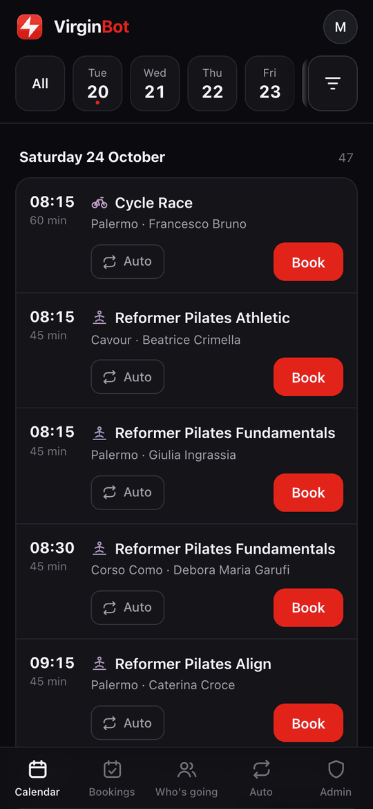
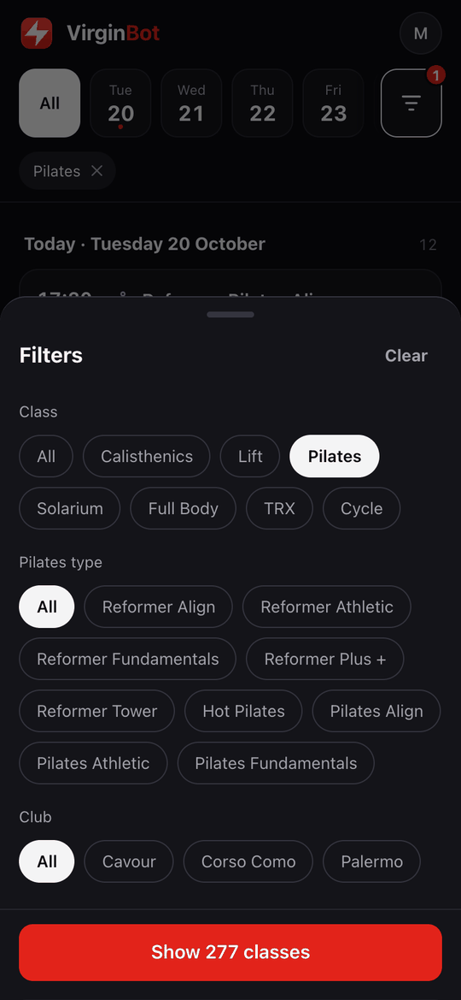
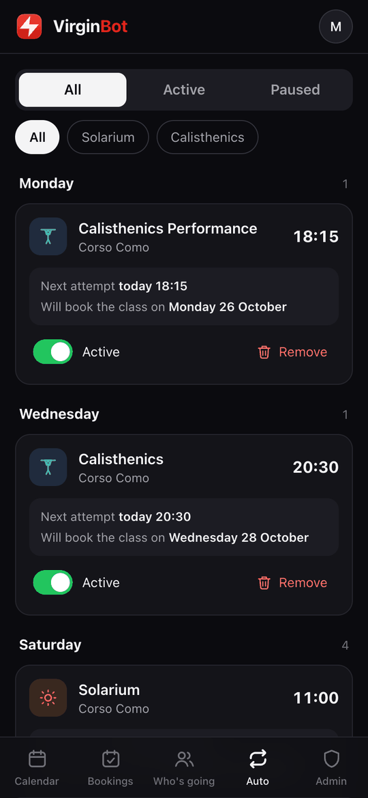

<div align="center">


# VirginBot

**Books your Virgin Active Italia classes the instant the booking window opens, and tells you the result on your phone.**

Pure Go · single static binary · no CGO · embedded mobile-first web app · Italian, Spanish and English

</div>

---

## Why

The popular classes at my gym (Calisthenics, Reformer Pilates, Solarium) fill up within seconds of their booking window opening, eight days in advance and at the exact class time, which is usually when I'm working or asleep.

VirginBot fixes that. You mark the weekly classes you care about, the bot wakes up at exactly the right moment, grabs the spot and sends the outcome straight to your phone. It's a small self-hosted web app; each person logs in with their own Virgin Active account.

> It started out scraping the Virgin Active website and ended up speaking the same private JSON API as the official mobile app.
> **[Read the reverse-engineering story →](docs/reverse-engineering.md)**

## Screenshots

| Calendar | Filters | Automations |
|:---:|:---:|:---:|
|  |  |  |
| Live classes for the next 10 days, one tap to book or automate. | Filter by class, Pilates variant and club. | Weekly rules with the next attempt and the class it will book. |

## Features

**Calendar**
- Live classes for the next 10 days across the configured clubs (Milano Corso Como, Milano Cavour, Palermo), with real availability: bookable, full or not yet open.
- A date strip to jump to a day, plus a filter sheet: class (Calisthenics, Lift, Pilates, Solarium, Full Body, TRX, Cycle), Pilates variant (Reformer Align, Athletic, Tower…) and club.
- Book and cancel in one tap. *My bookings* always matches the official app, because both read the same backend.

**Automations**
- Tap **Auto** on a class and VirginBot books that class **every week**.
- It tries at the class time on each day from the moment the window opens (8 days before; 2 for the Solarium) until 24 h before. Each attempt is a short burst of up to 9 tries over about a minute, because Virgin sometimes opens the slot a few seconds late.
- Cancelling one booking keeps the automation and only skips that date. You get a notice saying so, and booking that date again by hand clears the skip.
- Pause or remove any rule. Each rule shows when the next attempt is and which class it will book.

**Everything else**
- **Who's going:** see which other users have booked the same class, so you can go together.
- **Push notifications:** install the app on your phone's home screen, turn notifications on in the account sheet, and you get an instant "Booked ✓" or "Couldn't book" on the lock screen. Tapping it opens the right tab. Works on iPhone (iOS 16.4+, from the home-screen app) and Android.
- **Installable app:** add it to the home screen for a full-screen app with its own icon that opens instantly.
- **Multi-user:** an email allowlist, Virgin passwords encrypted at rest, and per-user sessions.
- **Admin view:** see, pause and remove every user's automations, and see everyone's upcoming bookings.
- **Three languages:** the web app and notifications are in Italian, Spanish and English, detected from the browser and changeable at any time.
- **Mobile first:** bottom navigation, bottom sheets, large touch targets and safe-area aware layouts; on desktop it becomes a centred layout with a floating nav bar.

## How the engine works

The engine doesn't poll. It works out the next instant it has to act, sleeps until then, and only then calls Virgin:

```
class on Mon 18:15, window opens 8 days before
                                                                 24 h before
 Sun 18:15 ── Mon 18:15 ── Tue 18:15 ── ... ── Sat 18:15 ── Sun 18:15 │ Mon 18:15
 (T-8: opens)   try            try                 try          try (last) │  class
```

- At each trigger it fetches **only that class's club**, finds the session and books it. For the Solarium it tries every bed until one accepts.
- If the booking API errors but the booking actually went through, a final check confirms it before reporting a failure, so you never get a false failure notice or a double booking.
- After a success it stops for that week; the rule stays active for the next one.

More detail in [docs/reverse-engineering.md](docs/reverse-engineering.md#architecture).

## Run it locally

Requires **Go 1.26+**.

1. Create a `.env` file in the repo root (it's git-ignored):

   ```dotenv
   APP_SECRET=<openssl rand -hex 32>   # encrypts stored passwords (required)
   VA_API_KEY=<x-api-key of the app>   # static key of the official app (required)
   VA_ALLOWED_EMAILS=you@example.com   # who may sign in (empty = anyone with a Virgin account)
   VA_ADMIN_EMAIL=you@example.com      # optional: unlocks the Admin tab and alerts
   ```

2. Start it:

   ```bash
   ./run.sh      # runs the app, opens the browser and keeps logs in ./logs/
   # or
   go run .
   ```

3. Open <http://localhost:8080> and sign in with your Virgin Active account.

> **Working on the UI against real accounts?** Start it with `VIRGINBOT_NO_ENGINE=1 go run .`
> The engine is off, so your local copy doesn't book alongside production. Book, Cancel and Auto in the UI still act on your real account.

Run the tests with `go test ./...`.

## Configuration

All settings come from environment variables. The `.env` file is loaded at startup without overriding variables already set in the environment.

| Variable | Required | Purpose |
|---|:---:|---|
| `APP_SECRET` | yes | Key used to encrypt stored Virgin passwords (AES-256-GCM). |
| `VA_API_KEY` | yes | The official app's static `x-api-key`. |
| `VA_ALLOWED_EMAILS` | | Comma-separated allowlist. Empty means open registration. |
| `VA_ADMIN_EMAIL` | | Admin user: Admin tab, plus a push notification if Virgin rejects the app credentials. |
| `VAPID_PUBLIC_KEY`, `VAPID_PRIVATE_KEY` | | Web Push key pair. Generate it once with `go run . vapid`. Without it there are no notifications at all. |
| `VAPID_SUBJECT` | | Contact for push services (`mailto:` or `https:`). Default: `mailto:` + `VA_ADMIN_EMAIL`. |
| `VA_EMAIL`, `VA_PASS` | | Seed the first user when the database is empty. |
| `ADDR` | | Listen address. Default `:8080`. |
| `VIRGINBOT_DB` | | SQLite file. Default `virginbot.db`. |
| `VIRGINBOT_ATTEMPTS`, `VIRGINBOT_GAP_SEC`, `VIRGINBOT_LEAD_SEC` | | Tune each trigger's burst: attempts (9), seconds between them (8), delay before the first (0). |
| `VIRGINBOT_DEBUG` | | `1` logs every engine evaluation. |
| `VIRGINBOT_NO_ENGINE` | | `1` disables the engine (local UI work). |

## Deploy (Fly.io)

The repo includes a multi-stage `Dockerfile` (distroless image, static binary with embedded timezone data) and a `fly.toml` (one always-on machine in Frankfurt with a persistent volume for SQLite).

```bash
fly apps create <name>
fly volumes create virginbot_data --region fra --size 1 -a <name>
fly secrets set -a <name> APP_SECRET=... VA_API_KEY=... VA_ALLOWED_EMAILS=... VA_ADMIN_EMAIL=...
fly secrets set -a <name> $(go run . vapid | tr '\n' ' ')   # push keys, never printed
fly deploy -a <name>
```

The engine has to run 24/7, so the machine can't scale to zero. Any always-on box at home (behind a Cloudflare Tunnel, for example) works just as well.

## Adding a club

Clubs are identified by vapi's numeric `clubId`. `GET /clubs`, with a signed-in user's token, lists every club in Italy.

1. Add the id and display name in [`calendar/calendar.go`](calendar/calendar.go).
2. Add it to the `clubs` list in [`main.go`](main.go).
3. If the club needs its own class selection, adjust the `keep` filter there.

## Security

- Virgin passwords are encrypted at rest with AES-256-GCM. `APP_SECRET` is mandatory; there is no insecure default.
- Sign-in is rate-limited per IP and can be restricted with an email allowlist.
- Session cookies are `HttpOnly`, `Secure` over HTTPS and `SameSite=Lax`, with a 30-day lifetime.
- `VA_API_KEY` is the app's public static key, but it still lives in secrets, not in the repo. If Virgin rotates it, the admin gets a push notification.
- `.env`, the database and traffic captures are git-ignored. No secrets are committed.

## Architecture

Pure Go with a single dependency tree and no CGO: SQLite via `modernc.org/sqlite`, and the web app (one vanilla HTML/CSS/JS file, no build step) embedded with `go:embed`.

| Package | Responsibility |
|---|---|
| `vapi/` | Client for Virgin's mobile API: login, classes, bookings, book, cancel. |
| `calendar/` | The `Class` model and the club id ↔ name mapping. |
| `automation/` | Rule store, skipped dates, and the precise-timing engine. |
| `account/` | Users and encrypted credentials. |
| `server/` | HTTP API, embedded web app, sessions, per-user API clients, bookings sync, admin. |
| `db/` | SQLite schema and idempotent migrations. |
| `i18n/` | Dates and notification text in it/es/en. |
| `push/` | Web Push: payload encryption (RFC 8291), VAPID (RFC 8292) and per-device subscriptions. Standard library only. |

## Motivation

Two goals. The first is to build a real application that's genuinely useful to the people who use it, me included: I book my own classes with it. The second is personal: getting hands-on with Go, a language I don't use at work but would like to.
