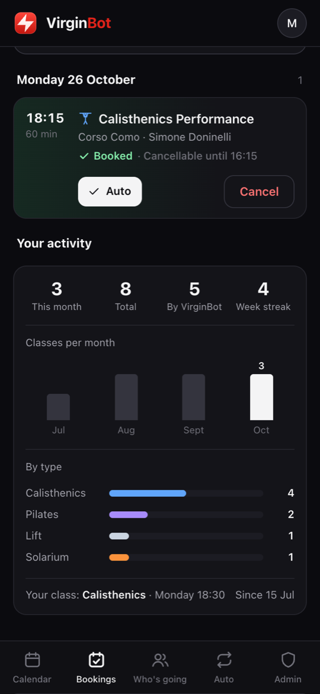

<div align="center">


# VirginBot

**Books your Virgin Active Italia classes the instant the booking window opens, and tells you the result on your phone.**

Pure Go · single static binary · no CGO · embedded mobile-first web app · Italian, Spanish and English

</div>

---

## Why

The popular classes at my gym (Calisthenics, Reformer Pilates, Solarium) fill up within seconds of their booking window opening, eight days in advance and at the exact class time, which is usually when I'm working or asleep.

VirginBot fixes that. You mark the weekly classes you care about, the bot wakes up at exactly the right moment, grabs the spot and sends the outcome straight to your phone. It's a small self-hosted web app; each person logs in with their own Virgin Active account.

> It started out scraping the Virgin Active website and ended up speaking the same private JSON API as the official mobile app.
> **[Read the reverse-engineering story →](docs/reverse-engineering.md)**

## Screenshots

| Calendar | Filters | Automations | Your activity |
|:---:|:---:|:---:|:---:|
|  |  |  |  |
| Live classes with spots left, one tap to book, automate or watch. | Filter by class, Pilates variant, club and instructor. | Watched classes and weekly rules with their next attempt. | Bookings with their cancel deadline, and your stats. |

## Features

**Calendar**
- Live classes for the next 10 days in **your clubs** (up to 5 of Virgin's 42 in Italy, your home club by default), either the popular ones (Calisthenics, Pilates, TRX, Cycle, Full Body, Lift, Solarium) or every class, with real availability: spots left, full ("Full · 3 waiting"), or when booking opens for *you* ("Opens Mon 18:15").
- A date strip to jump to a day, plus a filter sheet: class, Pilates variant, club (your home club by default) and instructor, with a searchable list where you star your favourite instructors.
- Book and cancel in one tap. Every booking shows until when it can still be cancelled (Virgin allows it up to 2 h before the class). A cancellation waits a few seconds behind an **Undo** button before it reaches Virgin.
- Opens instantly with the last calendar kept on the device, read only until the live one loads.
- **Waitlists:** join a full class's waitlist in one tap, see your position, and get a push notification the moment you're moved into the class.
- **Watch** a full class: VirginBot checks it every few minutes and books it as soon as a spot frees up, until 3 h before the class so you can still cancel it.

**Automations**
- Tap **Auto** on a class and choose **every week** or **just this once**.
- It tries at the class time on each day from the moment your booking window opens (8 days before for priority members, 2 for everyone else and for the Solarium) until 24 h before. Each attempt is a short burst of up to 9 tries over about a minute, because Virgin sometimes opens the slot a few seconds late.
- An automation that would overlap another one of yours is refused, saying which one it clashes with, and the bot never books a class that overlaps one you already have.
- If a class is still full 24 h before, it can just tell you, put you on its waitlist, or keep watching it for you (your choice).
- Cancelling one booking keeps the automation and only skips that date. Pause or remove any rule; each one shows its next attempt and the class it will book.
- **Holidays:** pick the days you're away and nothing is booked on them; the rules stay and resume after, and the bookings you already have in those days are listed so you can cancel them.

**Bookings and stats**
- **"Did you go?"** after each class, with one tap. Virgin doesn't expose attendance, so this is what makes the stats real.
- **Your activity:** classes this month, total, how many VirginBot booked, week streak, classes per month, split by type, and your usual class.
- A warning when you've skipped classes without cancelling: three in 30 days can get your bookings blocked for 15 days.
- Suggestions to automate the weekly classes you keep going to.

**Everything else**
- **Push notifications:** booked, couldn't book, a spot freed up, you're in from the waitlist, a reminder before each class (4 h by default) that opens a one-tap cancel confirmation for that booking, a friend booking one of your usual classes, the club cancelling a class you booked, moving it or changing its instructor, a Sunday evening summary of next week (booked, waitlisted and automations still without a spot), and your Virgin password stopping working. Works on iPhone (iOS 16.4+, from the home-screen app) and Android.
- **Who's going:** see who else booked a class, and book, automate or watch it from there.
- **Phone calendar:** a private `.ics` subscription link with your bookings.
- **Installable app:** add it to the home screen for a full-screen app with its own icon. You stay signed in, and the browser offers to save your password.
- **Multi-user:** an email allowlist, Virgin passwords encrypted at rest, and per-user sessions. Virgin sessions are renewed with their refresh token, so the password is only used to sign in again every 14 days.
- **Admin view:** every user's automations and bookings, the engine's health and its latest booking attempts with their outcome, and a one-tap download of a consistent copy of the database (an off-site backup on top of Fly's daily volume snapshots).
- **Three languages:** the web app and notifications are in Italian, Spanish and English.
- **Mobile first:** bottom navigation, bottom sheets you can swipe down, large touch targets and safe-area aware layouts.

## How the engine works

The engine doesn't poll. It works out the next instant it has to act, sleeps until then, and only then calls Virgin:

```
class on Mon 18:15, window opens 8 days before
                                                                 24 h before
 Sun 18:15 ── Mon 18:15 ── Tue 18:15 ── ... ── Sat 18:15 ── Sun 18:15 │ Mon 18:15
 (T-8: opens)   try            try                 try          try (last) │  class
```

- At each trigger it fetches **only that class's club**, finds the session and books it. Triggers due at the same time run in parallel, so one user's attempt never delays another's.
- Its state (booked, attempts, notices sent) is stored, so a restart or a deploy doesn't repeat anything.
- If the booking API errors but the booking actually went through, a final check confirms it before reporting a failure, so you never get a false failure notice or a double booking.
- After a success it stops for that week; the rule stays active for the next one. If the spot goes in the split second between checking and booking, Virgin puts you on the waitlist instead: the engine stops there and tells you your position.

More detail in [docs/reverse-engineering.md](docs/reverse-engineering.md#architecture).

## Run it locally

Requires **Go 1.26+**.

1. Create a `.env` file in the repo root (it's git-ignored):

   ```dotenv
   APP_SECRET=<openssl rand -hex 32>   # encrypts stored passwords (required)
   VA_API_KEY=<x-api-key of the app>   # static key of the official app (required)
   VA_ALLOWED_EMAILS=you@example.com   # who may sign in (empty = anyone with a Virgin account)
   VA_ADMIN_EMAIL=you@example.com      # optional: unlocks the Admin tab and alerts
   ```

2. Start it:

   ```bash
   ./run.sh      # runs the app, opens the browser and keeps logs in ./logs/
   # or
   go run .
   ```

3. Open <http://localhost:8080> and sign in with your Virgin Active account.

> **Working on the UI against real accounts?** Start it with `VIRGINBOT_NO_ENGINE=1 go run .`
> The engine is off, so your local copy doesn't book alongside production. Book, Cancel and Auto in the UI still act on your real account.

Run the tests with `go test ./...`.

## Configuration

All settings come from environment variables. The `.env` file is loaded at startup without overriding variables already set in the environment.

| Variable | Required | Purpose |
|---|:---:|---|
| `APP_SECRET` | yes | Key used to encrypt stored Virgin passwords (AES-256-GCM). |
| `VA_API_KEY` | yes | The official app's static `x-api-key`. |
| `VA_ALLOWED_EMAILS` | | Comma-separated allowlist. Empty means open registration. |
| `VA_ADMIN_EMAIL` | | Admin user: Admin tab, plus a push notification if Virgin rejects the app credentials. |
| `VAPID_PUBLIC_KEY`, `VAPID_PRIVATE_KEY` | | Web Push key pair. Generate it once with `go run . vapid`. Without it there are no notifications at all. |
| `VAPID_SUBJECT` | | Contact for push services (`mailto:` or `https:`). Default: `mailto:` + `VA_ADMIN_EMAIL`. |
| `VA_EMAIL`, `VA_PASS` | | Seed the first user when the database is empty. |
| `ADDR` | | Listen address. Default `:8080`. |
| `VIRGINBOT_DB` | | SQLite file. Default `virginbot.db`. |
| `VIRGINBOT_ATTEMPTS`, `VIRGINBOT_GAP_SEC`, `VIRGINBOT_LEAD_SEC` | | Tune each trigger's burst: attempts (9), seconds between them (8), delay before the first (0). |
| `VIRGINBOT_CANCEL_CUTOFF_MIN` | | How long before a class Virgin stops accepting cancellations. Default 120. |
| `VIRGINBOT_WATCH_CUTOFF_MIN` | | When watching a full class stops. Default: the cancel cutoff + 60. |
| `VIRGINBOT_DEBUG` | | `1` logs every engine evaluation. |
| `VIRGINBOT_NO_ENGINE` | | `1` disables the engine (local UI work). |

## Deploy (Fly.io)

The repo includes a multi-stage `Dockerfile` (distroless image, static binary with embedded timezone data) and a `fly.toml` (one always-on machine in Frankfurt with a persistent volume for SQLite).

```bash
fly apps create <name>
fly volumes create virginbot_data --region fra --size 1 -a <name>
fly secrets set -a <name> APP_SECRET=... VA_API_KEY=... VA_ALLOWED_EMAILS=... VA_ADMIN_EMAIL=...
fly secrets set -a <name> $(go run . vapid | tr '\n' ' ')   # push keys, never printed
fly deploy -a <name>
```

The engine has to run 24/7, so the machine can't scale to zero. Any always-on box at home (behind a Cloudflare Tunnel, for example) works just as well.

## Clubs and classes

Every club vapi lists (`GET /clubs`, all of Italy) can be picked from the account sheet; nothing to configure. The `clubs` list in [`main.go`](main.go) is only the fallback for members whose home club is unknown, and the `keep` filter there defines the "popular classes" choice. The three clubs in [`calendar/calendar.go`](calendar/calendar.go) keep their names fixed because stored bookings and rules are keyed by them.

## Security

- Virgin passwords are encrypted at rest with AES-256-GCM. `APP_SECRET` is mandatory; there is no insecure default.
- Sign-in is rate-limited per IP and can be restricted with an email allowlist.
- Session cookies are `HttpOnly`, `Secure` over HTTPS and `SameSite=Lax`, valid for 30 days since you last opened the app.
- The login form refuses posts from other sites (login CSRF).
- The calendar feed is authenticated only by a long random secret in its URL, which you can rotate from the app.
- `VA_API_KEY` is the app's public static key, but it still lives in secrets, not in the repo. If Virgin rotates it, the admin gets a push notification.
- `.env`, the database and traffic captures are git-ignored. No secrets are committed.

## Architecture

Pure Go with a single dependency tree and no CGO: SQLite via `modernc.org/sqlite`, and the web app (one vanilla HTML/CSS/JS file, no build step) embedded with `go:embed`.

| Package | Responsibility |
|---|---|
| `vapi/` | Client for Virgin's mobile API: login, classes, bookings, book, cancel. |
| `calendar/` | The `Class` model and the club id ↔ name mapping. |
| `automation/` | Rule store, skipped dates, overlaps, and the precise-timing engine with its persisted state, attempt log and watchdog. |
| `account/` | Users and encrypted credentials. |
| `server/` | HTTP API, embedded web app, sessions, per-user API clients, bookings sync, watches, reminders, history and stats, calendar feed, admin. |
| `db/` | SQLite schema and idempotent migrations. |
| `i18n/` | Dates and notification text in it/es/en. |
| `push/` | Web Push: payload encryption (RFC 8291), VAPID (RFC 8292) and per-device subscriptions. Standard library only. |

## Motivation

Two goals. The first is to build a real application that's genuinely useful to the people who use it, me included: I book my own classes with it. The second is personal: getting hands-on with Go, a language I don't use at work but would like to.
